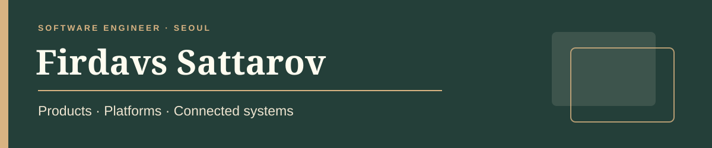

  

# Hi, I'm Firdavs — Fred

I'm a software engineer based in Seoul. I build web and mobile products, backend services, and software that connects to physical devices. My work spans the interface, API and data layers, through deployment and production support.

I enjoy taking on problems that cross those boundaries: improving slow application workflows, connecting devices reliably, and making existing systems easier to operate and maintain.

## What I work on

- **Applications and platforms:** React and Next.js interfaces, Flutter apps, and backend services in Python, Go and TypeScript.
- **Data and performance:** SQL and NoSQL data models, API design, query optimization, pagination and frontend data fetching.
- **Mobile and devices:** Kotlin and Swift integrations, device enrollment, authentication, offline access, BLE/NFC and ESP32 firmware.
- **AI and real-time features:** LLM API integration, prompt and response handling, WebSockets, Socket.IO and computer vision.
- **Delivery and operations:** Docker, Linux, Nginx, Azure, TLS, release tooling and production troubleshooting.

## Experience

**Software Engineer · HaeinS&S** | Jul 2026 – Present  
Develop mobile applications, backend APIs and administration portals. Improve data access and page-loading workflows; implement authentication, device communication and recovery; and support releases and production systems.

**Full Stack Developer / AI Engineer · VanCore Technologies** | Aug 2023 – Feb 2026  
Built NestJS and GraphQL/REST services with Next.js interfaces, real-time features and AI integrations. Deployed applications with Docker, Nginx and Linux.

**Frontend Developer · ClearPath Labs Inc.** | May 2022 – Apr 2023  
Built responsive interfaces and reusable components, integrated APIs, and improved frontend maintainability.

## Selected public work

**Commerce and community platform** — A customer-facing application with product discovery, accounts, orders, social content and administration. A NestJS monorepo separates GraphQL API services from scheduled ranking jobs.  
[Frontend · Next.js / Apollo](https://github.com/Firdavs001100/Shop-Corner-Next) &nbsp;·&nbsp; [Backend · NestJS / MongoDB](https://github.com/Firdavs001100/Shop-Corner)

**Retail platform** — A React storefront and Express backend with product and order flows, authentication, media uploads and a separate administration interface.  
[Frontend · React / Redux](https://github.com/Firdavs001100/ComfyZone-react) &nbsp;·&nbsp; [Backend · Express / MongoDB](https://github.com/Firdavs001100/ComfyZone)

My recent professional work also includes mobile access, connected equipment and operational systems. The company repositories are private; the public repositories above show earlier full-stack work.

## Tools and technologies

| Area | Technologies |
| --- | --- |
| Languages | TypeScript, JavaScript, Python, Go, Dart, Kotlin, Swift, Java, C/C++, C# |
| Web & backend | React, Next.js, NestJS, FastAPI, Express, GraphQL, REST, WebSockets, Socket.IO |
| Mobile & devices | Flutter, native Android/iOS, BLE/GATT, NFC/HCE, ESP32 |
| Data & operations | PostgreSQL, MariaDB/MySQL, MongoDB, SQL Server, SQLite, Docker, Linux, Nginx, Azure |
| AI & data | LLM APIs, PyTorch, OpenCV, NumPy, pandas |

## Connect

I'm interested in software engineering roles and freelance projects across product development, backend systems, AI-enabled workflows and connected devices.

[LinkedIn](https://www.linkedin.com/in/fred-the-engineer/) · [Email](mailto:foruseofbusiness@gmail.com)  
Seoul, South Korea · English, Korean, Turkish, Uzbek and Russian
